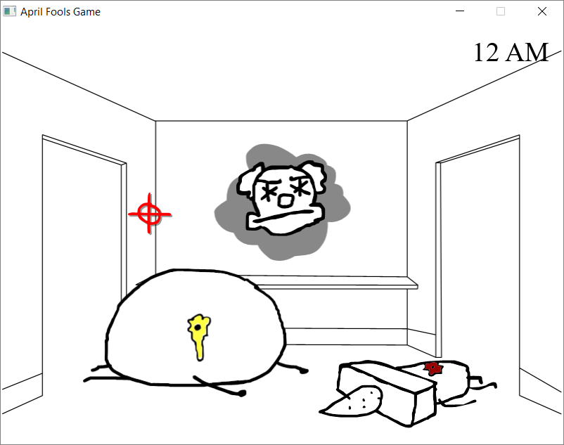

# OpenONAF2 April Fools

An open-source C++ &amp; SDL2 reimplementation of the engine for One Night at Flumpty's 2: April Fools (requires original game assets).

Development Note: Codebase structured and implemented by the author, with Claude AI utilized as a coding assistant for boilerplate generation and syntax reference.

Additional Note: Project was created in Visual Studio 2010. You can open this project in newer VS versions and upgrade it, if you want.

# How to get the resources?
To get the resources, you need to acquire the original One Night at Flumpty's 2 April Fools version from Jonochrome's GameJolt page and decompile the .exe file with JPEXS Free Flash Decompiler to acquire SVG sprites. Then put all SVG files to "Data/Sprites" and rename the files like this:
| Extracted Name | Correct Name |
| --- | --- |
| 14.svg | room.svg |
| 17.svg | cursor.svg |
| 21.svg | egg.svg |
| 24.svg | egg_shot.svg |
| 26.svg | buddy.svg |
| 29.svg | buddy_shot.svg |
| 32.svg | clown.svg |
| 34.svg | clown_blood.svg |

# Screenshot

  

